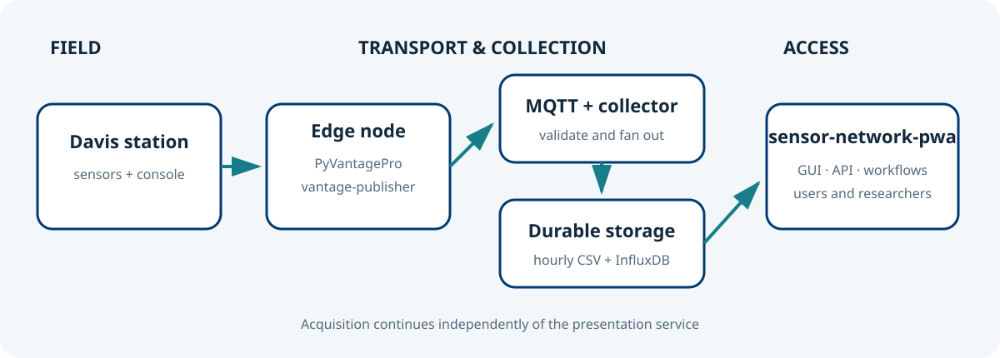

# sensor-network-pwa

Production readiness includes per-session CSRF protection, shared multi-worker login
and reset throttling, restrictive browser security headers, dependency readiness at
`/health`, a non-root digest-pinned container, and built-in load/backup verification
commands. See [operations](docs/operations.md) and [Docker deployment](docs/docker.md).

Research-oriented Progressive Web App for discovering, visualising and using observations
from the meteo@uniparthenope sensor network. It combines public station dashboards,
controlled historical access, reproducible data APIs and event-driven workflows in one
responsive portal.



It was split out of [`sensor-network-collector`](https://github.com/CCMMMA/sensor-network-collector).
The collector ingests MQTT and writes hourly CSV files (and optionally InfluxDB); this
project only reads that data and serves it. It never connects to MQTT.

## Features

- Installable, responsive Bootstrap progressive web app with configurable branding,
  light/dark themes, a web manifest, service worker and offline shell
- Map-based station discovery on the home page, with per-station popups
- Data browsing per station: searchable parameter picker, shared axes per unit, paged table, statistics
- Publication-quality plots (vector SVG, PNG up to 1200 dpi) and CSV download of any time range
- Live station trend pages and a public sensor network dashboard, reading only the hourly files a view needs
- Public station dashboard with per-station trend-chart axis settings (JSON export/import)
- Per-user, per-station Browse and CSV/ZIP Download permissions; new users start with no station assignments
- Session- or bearer-authenticated query/download API and user-managed API tokens, gated by `Can API`
- Node-RED-style email workflows with editable connections and SVG/PNG/JPG export, independently gated by `Can workflows`
- Accounts: admin approval of requests, forced/self-service password change, reset by email
- Administration page with per-user and per-station rights tables, roles, and account enable/disable
- Watchdog anomaly detection and workflow evaluation, including shared conditions across multiple stations, with persisted state and email notifications
- Profile page where each user sets the notification time and acknowledges, snoozes, or clears notifications
- Web app logo and per-station logo upload
- Optional InfluxDB v2 reads that complement the CSV files on the public dashboards
- Built-in, responsive and searchable documentation rendered directly from the canonical
  `docs/*.md` files and `docs/images` assets
- Contributor pathway for deploying Davis Vantage Pro/Pro2 edge nodes with PyVantagePro,
  vantage-publisher and sensor-network-collector

## Requirements

- Python 3.10+ (CI checks 3.10–3.14; Docker uses 3.11)
- Read access to the collector's `pathStorage` directory, with write access to its
  `_logos` subdirectory for station logo uploads
- A database configured with `databaseUrl`/`DATABASE_URL` (PostgreSQL recommended in production),
  or a writable SQLite location (`authDbPath`) for development
- Optional: the collector's InfluxDB v2 bucket (read token), an SMTP relay

```bash
python3 -m venv .venv
source .venv/bin/activate
pip install -r requirements.txt
```

## Run

```bash
cp config.json.sample config.json
python3 main.py --config config.json
```

This starts the Flask development server on `httpHost:httpPort` together with the
watchdog that detects anomalies and evaluates enabled workflows. Options:

- `--config <path>` config file path (default `config.json`)
- `--watchdog-only` run only the watchdog, for deployments where Gunicorn serves the web application

Production:

```bash
PWA_CONFIG=/path/config.json gunicorn --workers 2 --bind 127.0.0.1:8080 webapp_wsgi:app
python3 main.py --config /path/config.json --watchdog-only
```

Run exactly one watchdog process: Gunicorn workers do not start it.

With Docker, copy `docker-compose.yml.sample` to `docker-compose.yml`; it runs the web
and watchdog services from the same image (see [Docker deployment](docs/docker.md)).

## Configuration

`config.json` is a JSON object; `config.json.sample` lists every key. The essential ones:

| Key | Purpose |
| --- | --- |
| `pathStorage` | Storage root written by the collector (read here, plus `_logos` for uploads) |
| `databaseUrl` | SQLAlchemy database URL; use PostgreSQL in production (environment: `DATABASE_URL`) |
| `authDbPath` | Backwards-compatible SQLite file used when `databaseUrl` is unset |
| `baseUrl` | URL users open; used in email links and to accept form submissions |
| `webSessionSecret` | Secret signing the session cookies |
| `webAppName`, `webAppShortName` | Names shown when the app is installed |
| `mapTileUrl`, `mapTileAttribution` | Home-map tile provider URL and required attribution |
| `adminUser`, `adminPassword` | Initial admin account, created only if missing |
| `influxdb`, `influxdb*` | Optional InfluxDB v2 read access |
| `smtp*` | Optional queued email delivery; `smtpQueueBatchSize` limits each watchdog batch |
| `watchdogIntervalSec` | Seconds between anomaly and workflow scans (minimum 10) |

Most keys can also come from environment variables; see the
[configuration reference](docs/configuration.md).

## Repository layout

```text
main.py                    command-line entry point (development server + watchdog)
sensor_network_pwa/        application package
  config.py, log.py, runtime.py       configuration, logging, process-wide state
  access_store/, validation.py        SQLAlchemy application database (one mixin per concern), validation
  storage.py, influx.py               collector CSV readers, optional InfluxDB queries
  intervals.py, charts.py, dashboard.py   time windows, chart settings, public dashboard model
  anomalies.py, workflows.py              anomaly and user-workflow evaluation
  watchdog.py, mailer.py                   scan loop and email delivery
  cli.py                              argument parsing and startup
  web/                                Flask app factory, request hooks, access helpers, one blueprint per area
  web/templates/<blueprint>/          page templates (extend base.html) and the service worker
  web/static/                         script and stylesheet of each page
webapp_wsgi.py             Gunicorn entry point (webapp_wsgi:app)
pyproject.toml             ruff and mypy configuration
requirements-dev.txt       development tools (ruff, mypy)
tests/                     unittest suite (temporary files only, no external services)
docs/                      configuration, web GUI, deployment and operations guides
config.json.sample         sample configuration
Dockerfile, docker-compose.yml.sample, nginx/   container deployment
.github/workflows/ci-cd.yml                     quality/security checks, tests on Python 3.10-3.14, image scan/SBOM, smoke test and GHCR publish
```

## System context

```text
Davis Vantage Pro/Pro2
  -> PyVantagePro + vantage-publisher
    -> MQTT broker
      -> sensor-network-collector
        -> hourly CSV under pathStorage (+ optional InfluxDB and Signal K)
          -> sensor-network-pwa (this project)
```

Set `pathStorage` to the directory the collector writes to. A `config.json` used by a
collector version that still embedded the web GUI can be reused unchanged: collector-only
keys (`mqttBroker`, `signalk*`, ...) are ignored here, and the default database file is
still `<pathStorage>/collector_auth.sqlite`, so existing accounts and policies are kept.

## Documentation

The repository and the running PWA use the same sources. Open **Docs** in the application
to browse and search every Markdown guide; `/docs/<name>` renders `docs/<name>.md`, and
documentation media is served from `docs/images`.

- [Documentation index and reader paths](docs/README.md)
- [Getting started](docs/getting-started.md)
- [Join the network: hardware, power, networking and software](docs/joining-the-network.md)
- [Using collected data, token procedure, Python and Node.js examples](docs/using-data.md)
- [Complete API and workflow reference](docs/workflows-api.md)
- [Architecture and data flows](docs/architecture.md)
- [Web GUI, access policies and screenshots](docs/webgui.md)
- [Configuration](docs/configuration.md), [operations](docs/operations.md),
  [Docker](docs/docker.md), and [production WSGI](docs/wsgi.md)
- [Development](docs/development.md), [CI/CD](docs/ci-cd.md),
  [data protection](docs/data-protection.md), and [migration](docs/migration.md)

## Tests

```bash
python3 -m unittest discover -s tests -v
```

## Security notes

- Change `adminPassword` immediately; an admin created with the default or a sample password
  cannot use the application until the password is changed. The same applies to users
  an admin flags for a password change.
- Set `baseUrl` to the URL users open: form submissions from other hosts are rejected.
- Set a strong `webSessionSecret` in production. An empty or sample value is never used
  to sign sessions: a random secret is generated and kept in the auth database instead.
- Serve the application behind TLS/a reverse proxy.
- Public station dashboards (`/public/station/<uuid>`) are readable without login for
  `open` and `account` stations. `restricted` stations are hidden from everyone except
  their assigned users and admins.
- The service worker caches only static assets; pages and API data are never stored
  on the device.
- `/api/query`, `/api/download`, and `/api/workflows` accept either a logged-in session or a user-managed Bearer token
  with `Can API` (administrators have it implicitly); that permission never bypasses
  per-station Browse or Download rights.
- `/api-tokens` lets API-enabled users create, rename, expire, and revoke their own
  tokens. Token secrets are shown once and stored only as hashes.
- Login attempts are not rate limited by the application; add a limit at the reverse
  proxy when the portal is exposed to the Internet.
- Pages load Bootstrap, Leaflet, and Chart.js from public CDNs and, by default, map
  tiles from OpenStreetMap, so browsers need Internet access. Configure a suitable
  tile provider for production traffic.

## License

See [LICENSE](LICENSE).
