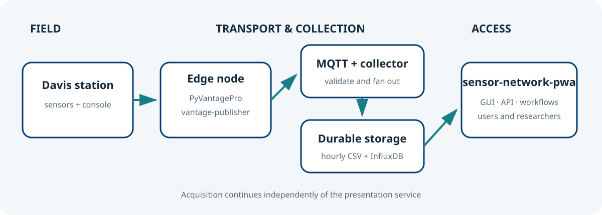

# Sensor Network PWA documentation

The meteo@uniparthenope portal is the observational and access layer of a distributed
environmental sensing system. It turns station measurements into discoverable,
permission-aware and reproducible data products without coupling the web tier to the
MQTT acquisition tier. These guides address visitors, data users, station contributors,
operators and developers.

*Figure 1. The project boundary. `sensor-network-pwa` reads collector-managed CSV and,
optionally, InfluxDB; it never communicates with MQTT or field hardware.*

## Choose a path

| Goal | Start here |
| --- | --- |
| Explore stations and install the PWA | [Getting started](getting-started.md) |
| Contribute a Davis Vantage Pro station | [Join the sensor network](joining-the-network.md) |
| Download observations or write a client | [Using collected data](using-data.md) |
| Create alerts from measurements | [Workflows and API reference](workflows-api.md) |
| Understand pages, roles and policies | [Web GUI and policies](webgui.md) |
| Understand components and data flow | [Architecture and data flows](architecture.md) |
| Deploy or administer the service | [Configuration](configuration.md), [operations](operations.md), [Docker](docker.md), [WSGI](wsgi.md) |
| Contribute code | [Development](development.md), [CI/CD](ci-cd.md) |

The running application renders these exact Markdown files under `/docs`. The **Docs**
menu provides the same navigation and searches every guide; images are served directly
from `docs/images`. Repository review and online publication therefore share one
canonical source rather than two copies that can diverge.

## Reference set

1. CCMMMA, [PyVantagePro](https://github.com/CCMMMA/PyVantagePro), communication tools for Davis Vantage Pro2 devices.
2. CCMMMA, [vantage-publisher](https://github.com/CCMMMA/vantage-publisher), edge publisher for weather observations.
3. CCMMMA, [sensor-network-collector](https://github.com/CCMMMA/sensor-network-collector), MQTT collection and storage service.
4. CCMMMA, [sensor-network-pwa](https://github.com/CCMMMA/sensor-network-pwa), this portal.
