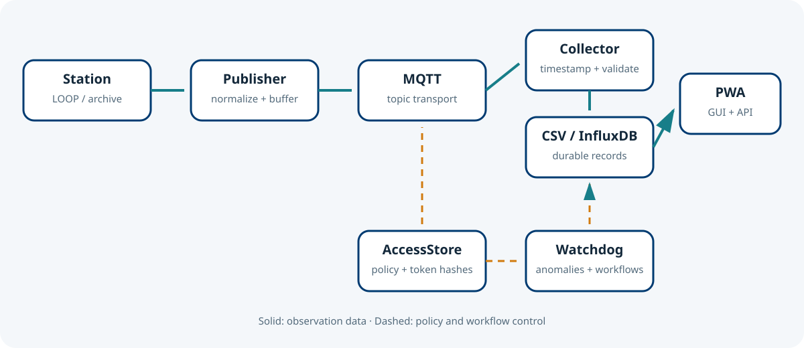
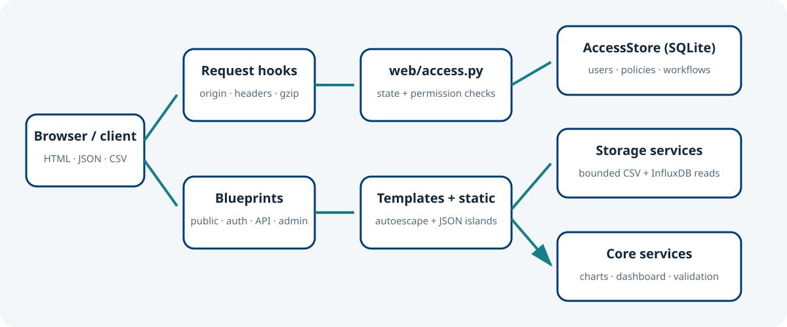

# Architecture and data flows

## Design thesis

The network follows a layered architecture in which acquisition, durable storage and
presentation are independently deployable. This separation limits failure propagation:
a temporary portal outage does not stop field acquisition, and an edge-node outage
does not invalidate previously collected records. The PWA is intentionally a reader of
collector outputs, not an MQTT consumer [1–4].

*Figure 1. End-to-end data flow. Solid arrows carry observations; the dashed control
path represents administrative policy and workflow definitions.*

## Component responsibilities

| Layer | Component | Responsibility |
| --- | --- | --- |
| Instrument | Davis Vantage Pro/Pro2 | Measures meteorological variables and maintains console/archive state. |
| Edge | PyVantagePro + vantage-publisher | Reads LOOP/archive records, normalizes the payload and publishes to MQTT. |
| Transport | MQTT broker | Decouples edge publishers from central consumers. |
| Collection | sensor-network-collector | Subscribes, validates timestamps and writes hourly CSV; optionally writes InfluxDB and Signal K. |
| Presentation | sensor-network-pwa | Reads bounded CSV intervals and optional InfluxDB data; applies accounts, policies, APIs and workflows. |

## PWA request architecture

*Figure 2. Internal dependency direction. Web blueprints use core services and the
`AccessStore`; core modules never import web modules.*

`create_web_app` builds an application without global application state. Request hooks
enforce cross-site write checks, forced password changes, security headers and gzip.
Blueprint views obtain configuration and the SQLite access store through `web/access.py`.
CSV queries are bounded by time and discover files newest-first, avoiding whole-history
scans on request paths.

## Data and control planes

The **data plane** comprises observation payloads, hourly CSV files, optional InfluxDB
series, query responses and ZIP downloads. The **control plane** comprises users,
station policies, permissions, chart settings, API-token hashes, workflow graphs,
anomaly state and queued email. Control-plane records reside in SQLite and must be
backed up together with configuration; observation retention is administered separately.

## Trust boundaries

Station names, field names and values originate outside the web service and are treated
as untrusted. Templates autoescape values; JavaScript uses JSON data islands and DOM
text nodes. API credentials are bearer secrets shown once and stored only as hashes.
The reverse proxy terminates TLS and should add rate limiting for Internet deployments.

## References

1. CCMMMA, [PyVantagePro](https://github.com/CCMMMA/PyVantagePro).
2. CCMMMA, [vantage-publisher](https://github.com/CCMMMA/vantage-publisher).
3. CCMMMA, [sensor-network-collector](https://github.com/CCMMMA/sensor-network-collector).
4. CCMMMA, [sensor-network-pwa](https://github.com/CCMMMA/sensor-network-pwa).
