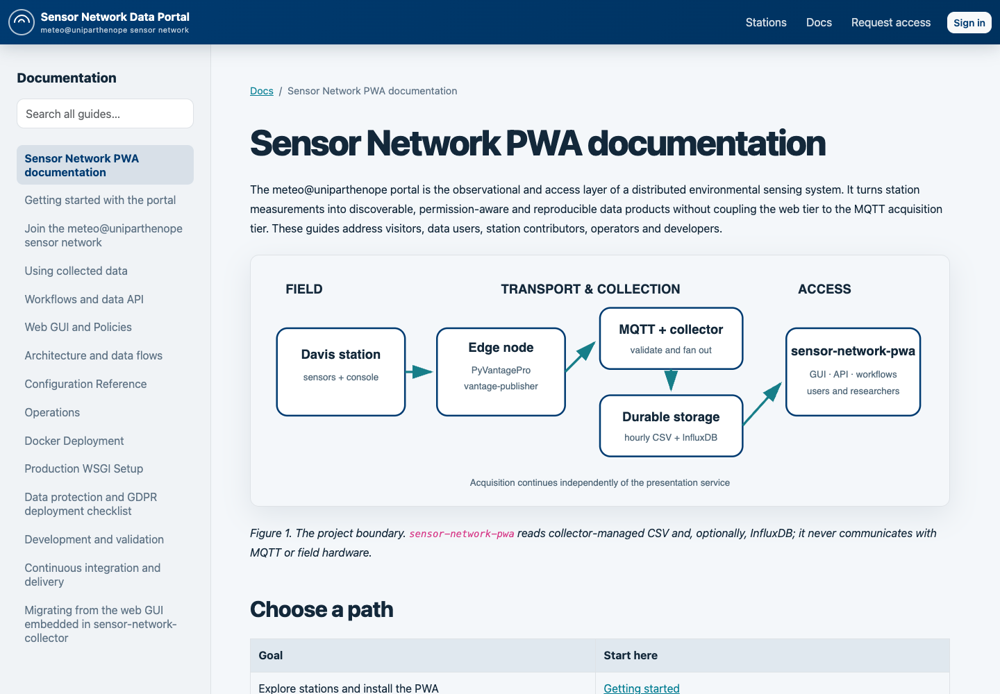
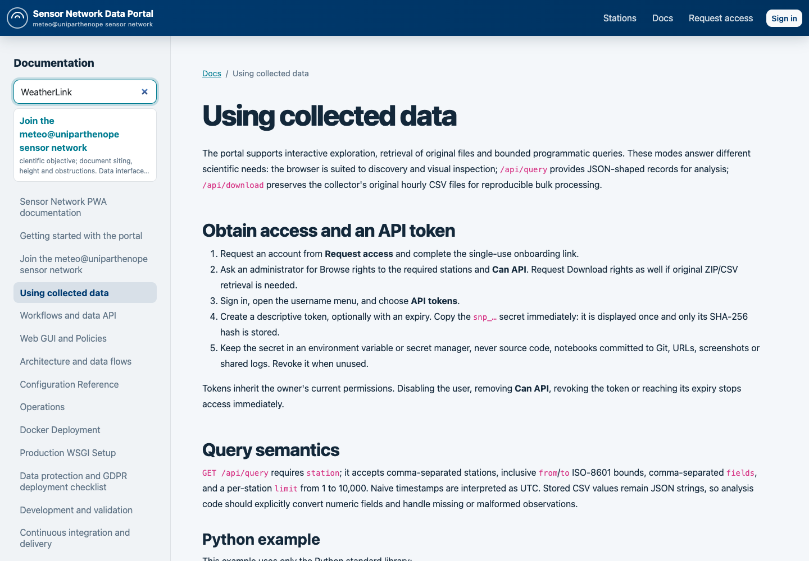

# Getting started with the portal

The portal supports two complementary forms of observation: a public, low-friction
view of current environmental conditions and an authenticated research interface for
historical analysis. The same responsive interface works in a desktop browser or as
an installed Progressive Web App (PWA).

## Explore the network

1. Open the home page and inspect the station map.
2. Select a station marker to see its identity, latest observation time and access policy.
3. Open an available public dashboard for current cards and short-term trends.
4. If historical browsing is available, open the station browser, choose an interval
   and select parameters with compatible physical units.
5. Use the table for exact values and export controls for CSV, SVG or high-resolution PNG.

Public visibility and downloadable data are distinct policy decisions. A station can
appear on the network map without granting anonymous access to its complete history.
This separation supports scientific visibility while respecting a contributor's data
governance requirements.

## Request an account

Choose **Request access**, provide the requested identity information, and submit the
form. An administrator reviews the request and sends a single-use onboarding link.
During onboarding you choose a username and password. New accounts deliberately begin
without station assignments; an administrator separately grants Browse, Download,
**Can API**, and **Can workflows** rights according to the intended use.

## Install the PWA

Use the browser's install action or the portal's **Install app** button. Installation
adds an application icon and standalone window, but it does not make observations
available offline. The service worker caches only the application shell and static
assets; pages and `/api/` responses remain network-only because they depend on current
permissions and current data.

## Find help

Open **Docs** in the global menu. The left navigation exposes every guide, and the
search box searches the canonical Markdown collection. Continue with
[Using collected data](using-data.md) for reproducible access or
[Join the sensor network](joining-the-network.md) to contribute observations.

*Figure 1. The documentation library at desktop width. Navigation and content remain
inside the PWA's shared application shell.*

*Figure 2. Full-collection search. Result text is inserted with DOM text nodes, so
documentation excerpts cannot inject executable markup.*
