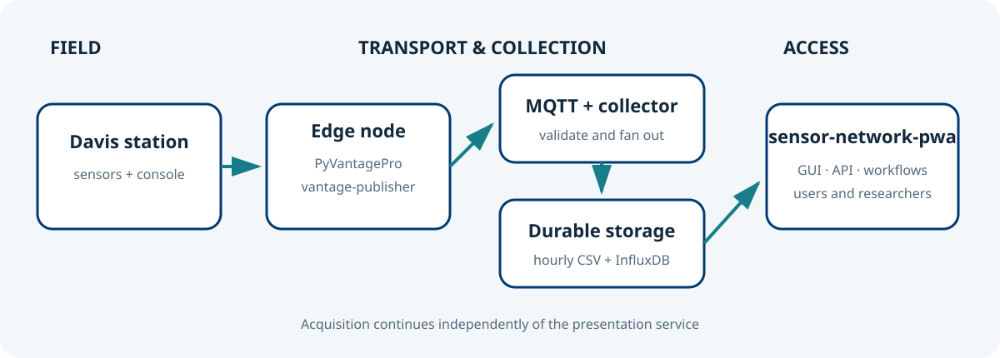

# Join the meteo@uniparthenope sensor network

Contributing a station extends the spatial and temporal value of the network. A useful
node is not merely a sensor: it is a maintained observational system whose siting,
clock, connectivity and power supply are documented. This guide describes the reference
Davis Vantage Pro/Pro2 edge stack and the information needed for onboarding [1–4].

## Reference hardware

| Component | Required capability | Planning notes |
| --- | --- | --- |
| Weather station | Davis Vantage Pro or Pro2 console and outdoor sensor suite | Select sensors appropriate to the scientific objective; document siting, height and obstructions. |
| Data interface | Davis WeatherLink USB/serial data logger or compatible console interface | The host normally exposes it as `/dev/ttyUSB0`; network interfaces may use TCP port 22222. Verify compatibility before purchase. |
| Minicomputer | Linux-capable computer with USB, persistent storage and Python 3 | A Raspberry Pi-class device is generally sufficient; choose an industrial device for harsh or unattended sites. |
| Network | Stable Internet path to the agreed MQTT broker | Ethernet is preferred; managed Wi-Fi or cellular can be used where signal and data plans are monitored. |
| Energy | Continuous, correctly rated power for console, interface, host and router | Use surge protection. For critical sites add a UPS; for solar sites size panel and battery from measured load, winter insolation and required autonomy. |
| Enclosure | Ventilated, serviceable protection appropriate to the site | Keep the minicomputer and USB interface dry and within rated temperature ranges. Do not compromise sensor exposure. |

No universal wattage or battery size is asserted here: measure the complete installation
under load and apply a design margin. Networking equipment can dominate an off-grid
power budget. Preserve local buffering so a short network outage does not become a data gap.

## Software chain

1. [PyVantagePro](https://github.com/CCMMMA/PyVantagePro) communicates with the Davis
   console, parses live LOOP and archive records, and exposes normalized values [1].
2. [vantage-publisher](https://github.com/CCMMMA/vantage-publisher) operates at the edge
   and publishes station observations to an agreed MQTT topic [2].
3. [sensor-network-collector](https://github.com/CCMMMA/sensor-network-collector)
   subscribes centrally and writes the canonical hourly CSV hierarchy; optional sinks
   include InfluxDB v2 and Signal K [3].
4. `sensor-network-pwa` reads those stored products and provides discovery, access
   control, analysis, downloads, APIs and alert workflows [4].

The edge node does not run this PWA, and the PWA never connects to the station or MQTT.

## Commissioning sequence

1. **Survey and record the site.** Record coordinates, elevation, sensor heights,
   exposure, nearby obstacles, ownership, maintenance contact and a site photograph.
2. **Install the station.** Follow Davis installation and grounding guidance. Confirm
   console reception and plausible readings before connecting software.
3. **Harden the host.** Install supported Linux, enable time synchronization, create a
   non-administrator service account, secure remote access, and configure updates.
4. **Verify the interface.** Grant serial-device access and use PyVantagePro to read
   station time, metadata and current values. Do not run two clients on one serial port.
5. **Configure publication.** Install `vantage-publisher`, assign the station identity
   and MQTT topic supplied by the operator, and keep broker credentials out of Git.
6. **Exercise outage behavior.** Disconnect networking, restore it, confirm buffered
   delivery, reboot the node and verify automatic service start.
7. **Request central onboarding.** Send the station identifier, site metadata, fields
   and units, cadence, contacts, visibility policy and commissioning evidence.
8. **Validate end to end.** Confirm collector messages, hourly CSV creation, map
   coordinates, dashboard units and bounded API queries.

## Acceptance checklist

- Timestamps are UTC/ISO-8601 and the host clock is synchronized.
- Coordinates and identity are stable and disclose no prohibited personal data.
- Values and units match the publisher/collector contract; sentinels are absent.
- Automatic restart, buffering, disk capacity and log rotation have been tested.
- Broker credentials are unique, least-privilege and operator-recoverable.
- A named person owns cleaning, calibration checks and incident response.

## Scientific stewardship

Joining creates a continuing obligation to preserve provenance. Record hardware changes,
relocations, firmware/software updates, calibration interventions and known periods of
degraded quality. Such metadata is essential when observations support climatological
comparison, model validation or teaching.

## References

1. CCMMMA, [PyVantagePro](https://github.com/CCMMMA/PyVantagePro), repository and examples.
2. CCMMMA, [vantage-publisher](https://github.com/CCMMMA/vantage-publisher), edge publication software.
3. CCMMMA, [sensor-network-collector](https://github.com/CCMMMA/sensor-network-collector), collection and storage service.
4. CCMMMA, [sensor-network-pwa](https://github.com/CCMMMA/sensor-network-pwa), data portal.
5. Davis Instruments, product-specific Vantage Pro/Pro2 console, sensor and data-logger manuals supplied with the installed hardware.
